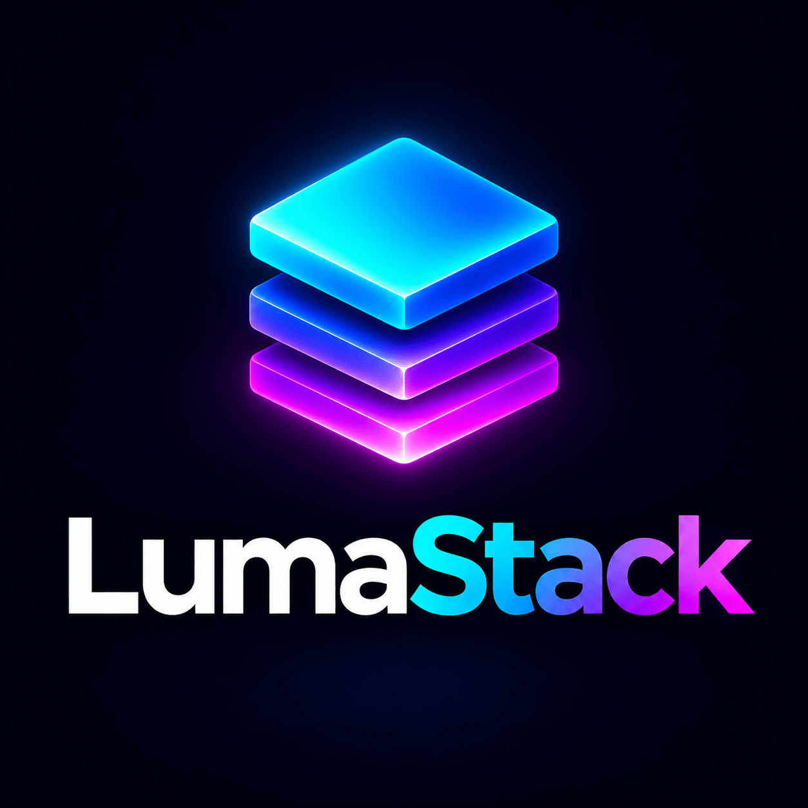
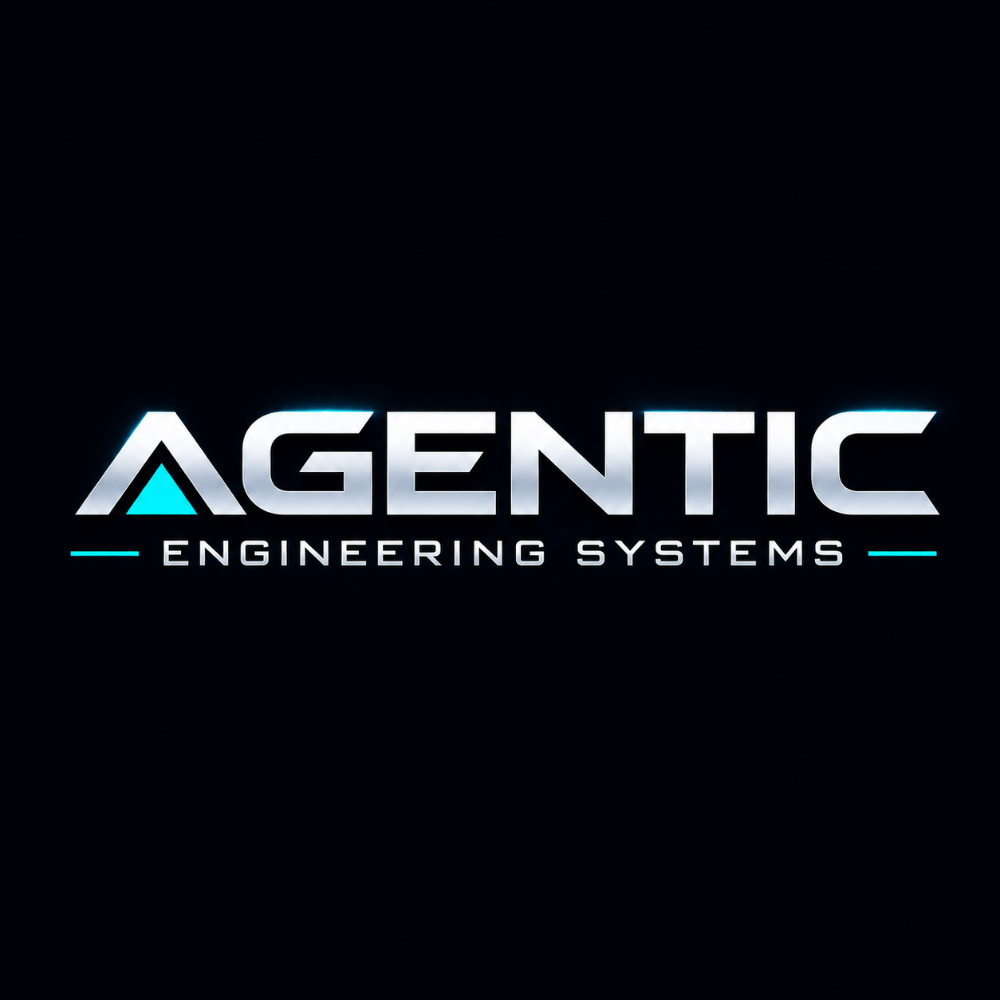
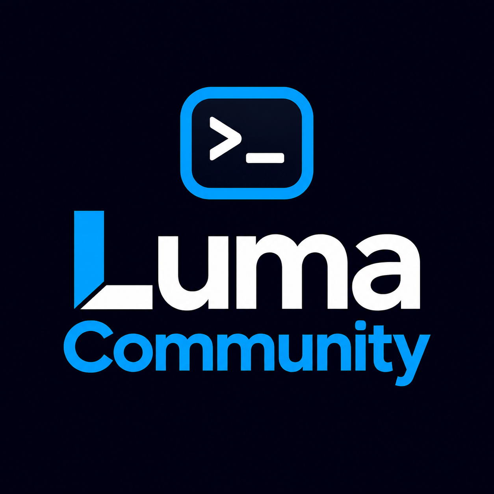
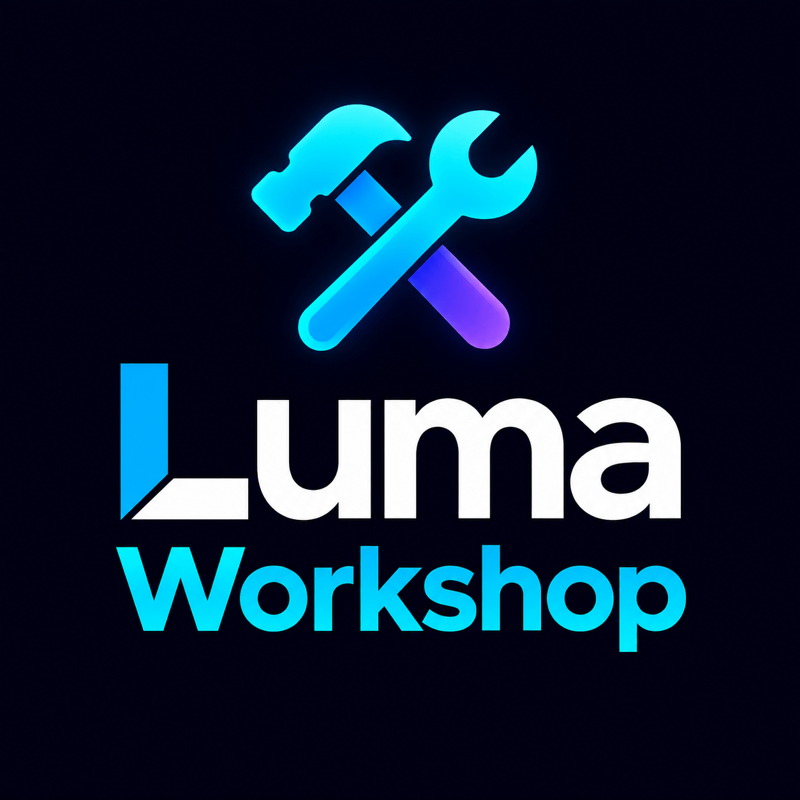

  <picture>
    <source media="(prefers-color-scheme: dark)" srcset="../assets/lumacorp-logo-dark.png">
    
  </picture>

## Developing

  
  &nbsp;&nbsp;
  
  &nbsp;&nbsp;
  

## Planned

  
  &nbsp;&nbsp;
  
  &nbsp;&nbsp;
  

